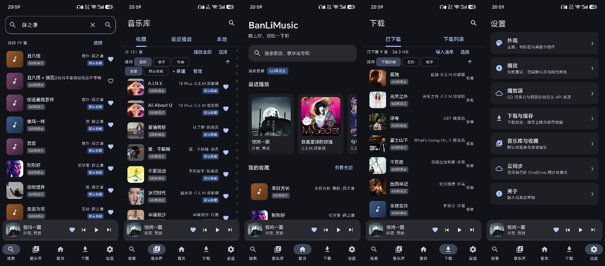
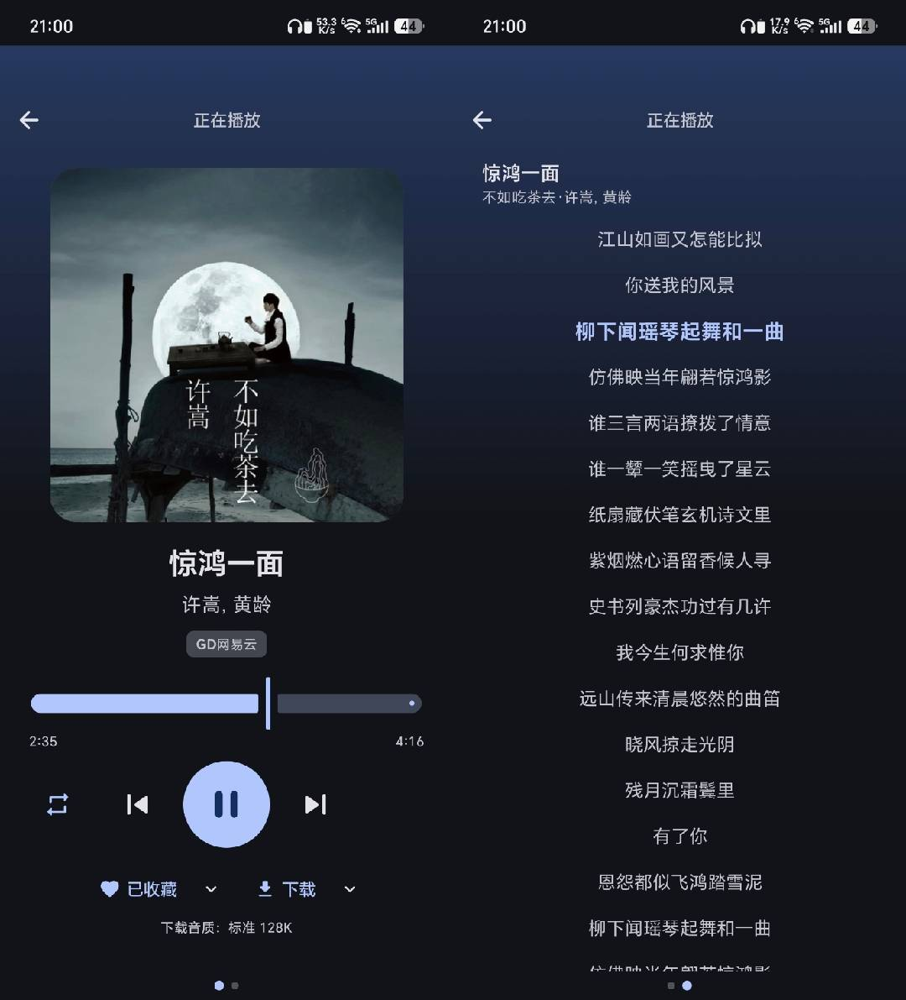
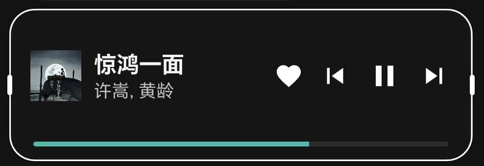
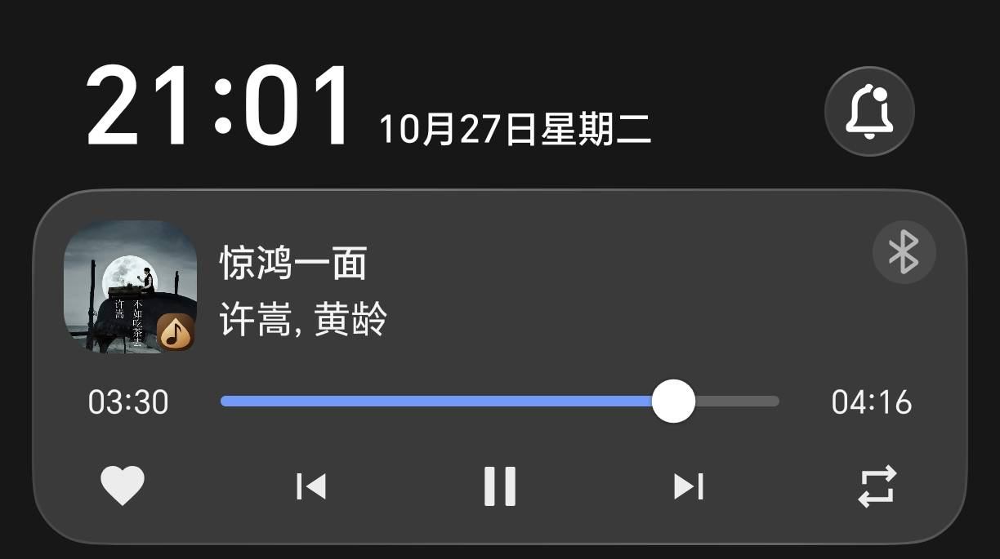
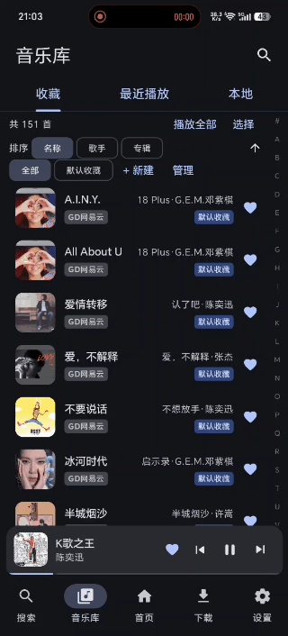
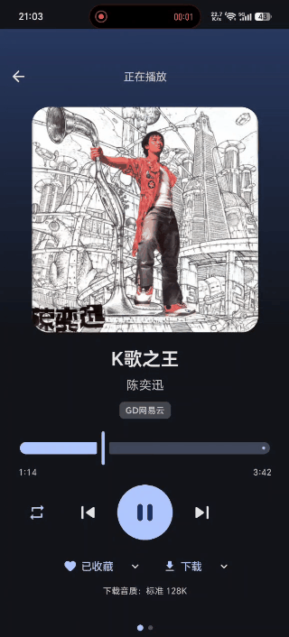
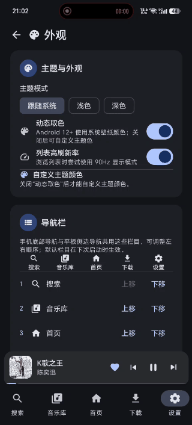

# BanLiMusic

一个按“多来源、可长期演进”设计的音乐客户端。当前接入 **GD 音乐台**（music.gdstudio.xyz）作为示例来源，未来可替换为自建音乐服务器或本地音乐，而不需要重写界面和播放器。

BanLiMusic 提供 Android 客户端与 Compose Desktop 桌面端，二者共用 Kotlin Multiplatform 核心。产品介绍与使用说明见本文；架构、构建、发布等开发文档见 [doc/](doc/README.md)。

## 界面预览

### 导航栏各页面

  

### 播放与歌词页面

  

### 桌面小组件与系统媒体控制

  
  

### 功能演示

  
  
  

## 功能亮点

- **多来源搜索**：同一关键字并发搜索多个来源，跨来源合并去重并按相关度排序；结果支持多选收藏或下载。
- **稳定播放**：基于 Media3 的后台播放、通知栏/锁屏控制、播放队列、循环与随机；播放失败自动退避重试，可轮转到同一首歌的其他来源。
- **已下载优先**：构建播放队列时优先使用本地已下载文件，断网也能播放。
- **歌词**：全屏播放器左滑进入歌词页，切歌与回到前台时自动请求，支持默认显示歌词。
- **个人音乐库**：收藏夹、最近播放、本地音乐与下载统一管理；一首歌可同时属于多个收藏夹，支持 JSON 导入导出、A-Z 快速索引、搜索与批量操作。
- **本地音乐**：通过 MediaStore 导入本地音频，不复制原始文件；已下载完成的歌曲自动加入本地列表。
- **下载与缓存**：断点续传、暂停/继续/取消/重试、前台进度通知；支持选择音质、下载歌词与海报，生成可迁移的 `banli-downloads.json` 清单；播放缓存可分类查看与清理。
- **桌面小组件**：3x1 / 4x1 两种尺寸，显示封面、标题、歌手、收藏与播放控制，支持磨砂配色与平滑进度刷新。
- **个性化**：动态取色或自定义主题色、底部导航排序、平板侧边导航与小播放器位置、手机/平板自适应布局。
- **可选云同步**：使用个人 Microsoft 账号把收藏夹与收藏歌曲双向同步到 OneDrive，不经过开发者服务器。
- **桌面端**：复用共享核心与共享 UI，提供首页、搜索、收藏夹、最近播放、本地音乐、下载管理、MP3 播放、歌词、缓存与设置。

## 下载与安装

- **Android**：支持 Android 8.0（API 26）及以上。发布包命名为 `BanLiMusic-<version>-release.apk`，安装前请在系统中允许来自浏览器的未知来源安装。
- **桌面端**：Linux x64 便携版 `BanLiMusic-<version>-linux-x64.tar.gz` 内置 runtime，解压即可运行；另提供 Linux/Windows 的 no-jre 便携版、no-jre deb/rpm/MSI（需 Java 17+），以及带 runtime 的 deb/rpm 与 exe/msi 安装包。详见 [发布与打包](doc/development/release.md#桌面端发布包)。

## 数据来源与声明

音乐数据来自 **GD 音乐台（music.gdstudio.xyz）**，API 由 GD Studio 提供，采用 CC BY-NC 4.0 许可。

- 该平台仅用于学习参考，**请勿用于商业用途**，请勿下载、传播受版权保护的内容。
- 当前 API 限流为 5 分钟 50 次请求；应用已内置客户端限流，但服务端仍然可能拒绝请求。
- 播放地址通常带时效，应用只做短时缓存；不要把临时播放 URL 当作永久下载地址。
- 若要长期使用或分发，请改为接入拥有合法授权的自建音乐服务器。

## 已知限制

- 尚未实现独立歌单、账号体系与自建服务器适配器；OneDrive 同步目前仅 Android 端。
- 列表页默认不主动请求专辑封面，可在“下载与缓存”设置中开启；开启后会占用 5 分钟 50 次的 API 请求额度。
- 中文 A-Z 首字母使用轻量 GB2312 映射，多音字和生僻字可能出现近似结果。
- 桌面端产物默认不带代码签名；Windows 未签名包可能触发 SmartScreen“未知发布者”提示，Linux 下载包建议校验 `SHA256SUMS-<version>.txt` 与 GPG 签名。签名方式见 [发布与打包](doc/development/release.md#桌面端产物签名)。
- 已在真机验证主要播放、下载与小组件流程；不同厂商桌面和系统版本仍需分别验证。

完整功能清单与限制见 [功能现状与已知限制](doc/features.md)。

## 开发文档

- [开发文档索引](doc/README.md)
- [架构说明](doc/architecture.md)
- [功能现状](doc/features.md)
- [开发环境](doc/development/environment.md)
- [构建与测试](doc/development/build.md)
- [发布与打包](doc/development/release.md)
- [OneDrive 云同步](doc/cloud-sync.md)
- [GD 音乐台 API 参考](GD_MUSIC_API.md)
